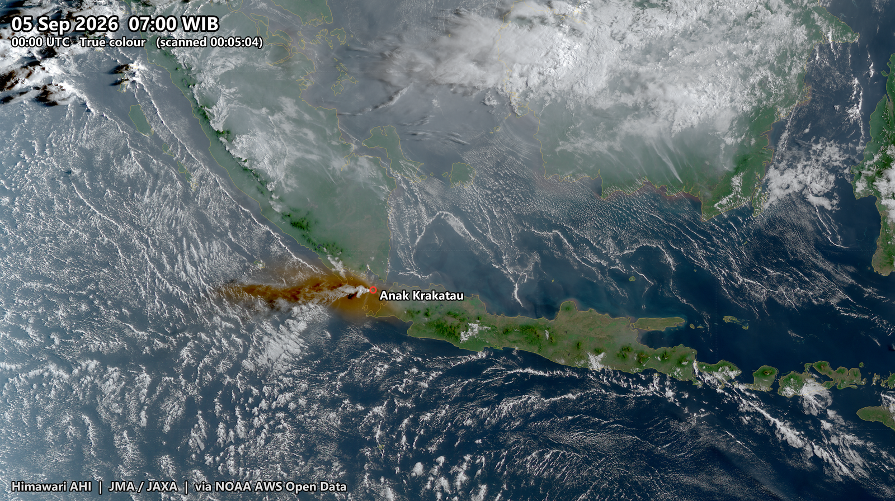

# Himawari

A pipeline for **historical** Himawari imagery: fetch the raw Level 1b archive
for any past date and region, build calibrated RGB composites, reproject them
onto a stable map grid, and animate.

JMA's public imagery page serves pre-rendered JPEGs and keeps the last 24 hours.
Anything older has to come from the archive as Himawari Standard Data, which is
instrument-geometry, per-band, per-segment, and not directly viewable. This
repository does the whole path from there to an MP4.



The worked example throughout is the **Anak Krakatau eruption of 4 to 6
September 2026**, written up in
[Ten minutes over the Sunda Strait](https://benny.istan.to/blog/20260907-ten-minutes-over-the-sunda-strait).

A second example in `examples/tonga.yml` covers **Hunga Tonga-Hunga Ha'apai on
15 January 2022** using Himawari-8, to show that nothing here is specific to the
first one.

---

## What you can ask it for

| | |
|---|---|
| **When** | any 10-minute slot from 7 July 2015 to roughly an hour ago |
| **Where** | any lat/lon box on the visible disk, from the whole hemisphere to a single strait |
| **What** | any of 16 bands, singly or combined into a dozen RGB composites |
| **How** | annotated PNG frames, MP4, GIF, side-by-side panels |

All four are set in [`config.yml`](config.yml). No code changes are needed to
point it somewhere else.

---

## Quick start

```bash
conda env update -n climate -f environment.yml
conda activate climate
jupyter lab
```

| Notebook | |
|---|---|
| [`01_download.ipynb`](notebook/01_download.ipynb) | availability check, size estimate, resumable parallel fetch, integrity verification |
| [`02_process.ipynb`](notebook/02_process.ipynb) | Standard Data to calibrated composites, reprojected and annotated |
| [`03_animate.ipynb`](notebook/03_animate.ipynb) | frames to MP4, GIF and side-by-side panels |

The logic lives in [`src/himawari/`](src/himawari) so the notebooks stay
readable.

**On Windows, activate the environment properly.** Calling
`envs/climate/python.exe` by its path is not equivalent to `conda activate`,
and every compiled package then dies with a silent exit code 127 rather than an
ImportError.

---

## How far back the archive goes

Measured directly from the public buckets by listing them, not quoted from
documentation:

| Bucket | First slot | Last slot | Coverage |
|---|---|---|---|
| `noaa-himawari8` | 2015-07-07 02:00 UTC | 2022-12-13 | continuous; plus an isolated block 11 Oct to 26 Nov 2025 |
| `noaa-himawari9` | 2022-11-01 (one test day 28 Oct) | now, to within about an hour | continuous |

Together that is **an unbroken record from 7 July 2015 to the present**, which
is essentially the whole Himawari-8/9 era. Set `source.satellite` to `H08` or
`H09` to pick the right one for your date.

The handover is visible in the data itself. On 2022-12-13 Himawari-9 has its
usual 142 slots while Himawari-8 drops to 29 and then stops, matching the
13 December 2022 handover date
[JMA publishes](https://www.data.jma.go.jp/mscweb/en/oper/status.html).

Both buckets also carry `AHI-L1b-Japan` and `AHI-L1b-Target` (2.5-minute
regional scans) and several L2 products. This pipeline reads full disk;
the others are not wired up.

### Two sources

| | AWS `noaa-himawari8/9` | P-Tree `ftp.ptree.jaxa.jp` |
|---|---|---|
| Registration | none | [required](https://www.eorc.jaxa.jp/ptree/registration_top.html) |
| Protocol | HTTPS, parallelises freely | FTP, a few connections at most |
| Layout | one directory per 10-min slot | `/jma/hsd/YYYYMM/DD/HH/` |
| Also carries | some L2 products | `/pub/` geophysical parameters, gridded netCDF |

Both distribute Himawari Standard Data for the same timeslots under the same
JMA naming convention. AWS is the default; P-Tree is an interchangeable backend
(`source.backend: ptree`, credentials in `.env`).

*Not claimed:* that the two are byte-identical. It is often said, it may well be
true, and it has not been tested here.

---

## Configuring a run

```yaml
event:                          # the marker and the clock; omit for none
  name: Anak Krakatau
  lon: 105.423
  lat: -6.102
  timezone_offset_hours: 7
  timezone_label: WIB

window:
  start_utc: 2026-09-03 17:00
  end_utc:   2026-09-06 17:00
  step_minutes: 10              # multiples of 10; AHI's full-disk cadence

source:
  backend: aws
  satellite: H09                # H08 for dates before 13 Dec 2022

grids:                          # optional; merged over the built-ins
  my_area:
    extent: [95.0, -12.0, 120.0, 2.0]     # lon_min lat_min lon_max lat_max
    resolution: 0.02                       # deg/px; 0.02 ~ 2 km, 0.005 ~ 0.5 km

products:
  - composite: ash
    grid: my_area
```

The **band list is derived from the product list**, so removing a composite
genuinely shrinks the download. Which segments to fetch is derived from the
grid extents by solving the geostationary projection, so an unfamiliar region
needs no lookup table.

`examples/tonga.yml` is the same file pointed at a different volcano, satellite,
hemisphere and timezone. `python examples/run_tonga.py` runs the whole pipeline
against it in under a minute.

---

## Products

| Composite | Channels | Day | Night |
|---|---|---|---|
| `true_color` | B01-B04, sharpened to 0.5 km | yes | no |
| `true_color_reproduction` | B01-B04, JMA's CIE XYZ rendering | yes | no |
| `natural_color` | B03, B04, B05 | yes | no |
| `ash` | B11, B13, B14, B15 | yes | yes |
| `dust` | same four, different stretch | yes | yes |
| `night_microphysics` | B07, B13, B14, B15 | yes | yes |
| `cloudtop` | B07, B14, B15 | yes | yes |
| `volcanic_emissions` | B09, B10, B11, B13 | yes | yes |
| `B13`, `B08` | single band, greyscale | yes | yes |
| **`true_color_night_ir`** | true colour fading to greyscale IR | yes | yes |
| **`true_color_night_ash`** | true colour fading to the ash RGB | yes | yes |
| **`true_color_night_microphysics`** | true colour fading to night microphysics | yes | yes |

The last three are day/night blends: a `DayNightCompositor` mixes on solar
zenith angle, fully daylight below 85 degrees, fully the night product above 88,
so one animation runs continuously through sunset instead of going black.

Satpy's own `true_color_with_night_ir` needs a global NASA Black Marble GeoTIFF
fetched through pooch; that download currently fails a pinned checksum because
the file was reissued upstream. The blends here use products already computed
from bands in hand, so they need no network and no static imagery.

Two composites are defined locally in [`config/satpy/`](config/satpy) because
satpy does not ship them for AHI: the CIRA **SO2 / volcanic emissions** RGB
(shipped for ABI and FCI only) and the two green-band demonstrations used in
the write-up. Satpy merges these with its built-in AHI set rather than replacing
it.

---

## What it costs

Measured on the worked example: three days, 10-minute cadence, a 25 x 14 degree
box, segments 5 to 7.

| Product set | Per timeslot | Three days |
|---|---|---|
| Ash or dust RGB only | 33 MB | ~12 GB |
| Everything the default products need | 190 MB | **77.6 GB** |
| All 16 bands | 214 MB | ~81 GB |

Band 3, the 0.5 km red channel true colour sharpens with, is roughly half the
payload.

On 80 cores with 6 render workers: downloads at ~19 MB/s, four infrared
composites at 1.6 s per timeslot, true colour at 0.5 km at 18 s per timeslot.
Both stages are resumable, so re-running a cell picks up where it stopped and
never re-does finished work.

---

## Verification

Every quantitative claim above was checked against something other than this
code before being written down. The forward geostationary projection in
`catalog.geos_line_col` agrees with an independent pyproj `+proj=geos`
implementation to **0.000 pixels** across six test points from Tokyo to
Colombo; the band table matches JMA's published Table 1; the segment geometry
was verified against satpy's own `AreaDefinition` built from file headers
rather than from our arithmetic; and the download size estimator predicted
192 MB per timeslot against 190 MB actually fetched.

`render.verify_requirements()` is the part of that worth running yourself. It
resolves each composite's band dependencies out of satpy's own configuration
and compares them with the static table this package uses to decide what to
download:

```python
from himawari import render as R
R.use_local_config()
print(R.verify_requirements() or "table matches satpy")
```

Notebook 02 runs it before rendering anything, so a mismatch stops the run
rather than quietly producing frames from the wrong channels.

---

## Known limitations

- **Parallax is not corrected.** A plume top 15 km up, viewed at Krakatau's
  41.5 degree zenith angle, is drawn about 13 km from the vent. Correcting it
  needs the plume height, which is usually the unknown.
- **A frame is not simultaneous with itself.** The imager sweeps north to south;
  three segments span 208 seconds between the top and bottom edges of a frame.
- **142 full disks per day, not 144.** AHI pauses for housekeeping at 02:40 and
  14:40 UTC. Verified over six consecutive days.
- **Full disk only.** The 2.5-minute Japan and Target scans are in the buckets
  but not wired up.
- **Cropping is skipped near the antimeridian**, so grids there render more
  slowly. Correct, just not optimised.

---

## Repository layout

```
config.yml                window, region, products, paths, worker counts
config/satpy/             local composites: SO2 RGB and the day/night blends
environment.yml           packages to add to an existing conda environment
notebook/
  01_download.ipynb       availability, size estimate, resumable fetch
  02_process.ipynb        Standard Data to annotated frames
  03_animate.ipynb        frames to MP4 and GIF
src/himawari/
  catalog.py              filenames, AWS/P-Tree paths, timeslots, segment geometry
  fetch.py                AwsBackend / PTreeBackend, parallel resumable download
  render.py               grids, Scene loading, resampling, composites, annotation
  animate.py              gap filling, MP4, GIF, side-by-side panels
  project.py              reads config.yml, derives bands and segments from it
examples/
  tonga.yml               a second event, satellite and hemisphere
  run_tonga.py            runs the whole pipeline against it end to end
```

Downloads, frames, encoded video and scratch output all live outside version
control; see `.gitignore`. Nothing tracked here is generated, so a clone plus
`config.yml` reproduces everything.

---

## Credit

Observations by the Japan Meteorological Agency (Himawari-8/9 AHI). Archive by
JAXA P-Tree, mirrored by NOAA on
[AWS Open Data](https://registry.opendata.aws/noaa-himawari/). Processing with
[Satpy](https://satpy.readthedocs.io) and
[Pyresample](https://pyresample.readthedocs.io). Eruption reporting by
[PVMBG / MAGMA Indonesia](https://magma.esdm.go.id).

SO2 RGB recipe from the [CIRA quick guide](https://rammb.cira.colostate.edu/training/visit/quick_guides/Quick_Guide_SO2_RGB.pdf).
Hybrid green from Miller et al. (2016),
[BAMS 97(10)](https://journals.ametsoc.org/view/journals/bams/97/10/bams-d-15-00154.1.xml).

If you publish anything made with this, credit JMA for the observations and JAXA
for the archive.
